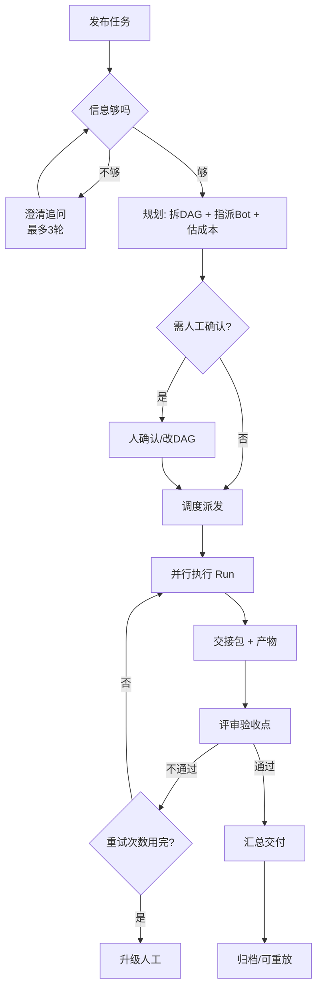

# DSHBot 需求规格（草案 v0.1）

> ⚠️ 已被 [DSHBot-需求规格-v1.0.md](DSHBot-需求规格-v1.0.md) 取代，保留作决策过程记录。

> **一句话定位**：发布一条任务，DSHBot 按任务内容组建一支 Bot 小队，自动拆解、并行推进、互相评审，最终交付可验收的产物与完整过程记录。

- 文档状态：草案，待决策项见第 11 节
- 基线能力：DeepSeek Harness（下称 DSH）
- 编写日期：2026-11-06

---

## 1. 背景与问题

DSH 已经能完成"单个 agent 干一件具体的事"：写代码、查资料、处理文档。但真实任务往往不是单线程的：

- 「把这段需求做成能上线的功能」需要需求澄清、方案设计、实现、测试、评审，角色不同、上下文不同；
- 「调研三个竞品并给结论」可以并行，但人得手动开三个会话、来回搬运上下文；
- 出了问题（跑偏、失败、超预算），没有统一的暂停、重试、追责入口。

**现状的四个痛点**

| 痛点 | 具体表现 |
|---|---|
| 手工编排 | 人肉开多个会话、手动复制上下文、手动合并结果 |
| 过程不可见 | 不知道哪个 bot 在干什么、花了多少、卡在哪 |
| 产物散落 | 结果在会话里，没有版本、没有验收、没法复用 |
| 失败不可控 | 跑偏只能重来，没有重试、降级、熔断、人工接管 |

**目标**：把"多 Bot 协作"从手工操作变成一次发布、自动编排、全程可视、结果可验收。

---

## 2. 产品定位与边界

**是什么**：DSH 之上的一层**任务编排层**（Task Orchestration Layer）。DSH 负责"一个 Bot 怎么把一件事做好"，DSHBot 负责"一支 Bot 小队怎么把一件大事做成"。

**不是什么（第一版刻意不做）**

- 不是新的模型、不是新的 IDE、不是新的 Agent 框架；
- 不替换 DSH 的会话、工具、沙箱能力，只调用它们；
- 不做多租户 SaaS、不做 Bot 训练/微调、不做通用工作流 BPM。

**核心差异点**：Bot 是按任务**动态组建**的，不是人预先配好一条固定流水线。

---

## 3. 用户与场景

| 角色 | 说明 | 关键诉求 |
|---|---|---|
| 发布者（人） | 提任务、看进度、做验收 | 一句话能开工；随时知道进展；结果能用 |
| Bot | 承担子任务的执行单元 | 拿到刚好的上下文；有明确的完成标准 |
| 审核者（人，可选） | 关键节点放行 | 只在要拍板时被打扰 |

**场景 S1 · 单人研发（核心场景）**
输入：一句需求 + 仓库路径 + 验收标准。
过程：需求分析师澄清 → 工程师改代码 → 测试跑用例 → 评审员对照验收点判定。
输出：变更 diff、测试报告、验收结论、成本账单。

**场景 S2 · 调研与内容**
输入：调研命题 + 输出格式要求。
过程：拆成 3–5 个并行调研子任务 → 汇总 → 事实核查 bot 逐条校验。
输出：结构化报告 + 引用来源 + 存疑清单。

**场景 S3 · 故障排查**
输入：现象描述 + 日志。
过程：并行生成多个假设，各自验证，互相证伪，收敛到根因。
输出：根因判断 + 证据链 + 修复建议。

> S1 决定 MVP 范围，S2/S3 验证编排模型的通用性。

---

## 4. 核心概念模型

| 概念 | 定义 | 关键属性 |
|---|---|---|
| **Task 任务** | 一次发布 | 目标、输入材料、验收标准、约束（时间/预算/技术栈）、优先级、状态 |
| **Subtask 子任务** | DAG 上的一个节点 | 描述、依赖、指派 Bot、输入引用、**输出契约**、验收点 |
| **BotTemplate 模板** | 可复用的角色定义 | 角色提示词、工具白名单、技能包、模型、默认预算、输出契约 |
| **BotInstance 实例** | 模板 + 本次任务的上下文 | 工作目录、session、预算余额、状态 |
| **Run 执行** | 一次 Bot 跑一次子任务 | 输入清单、事件流、token/耗时/成本、产物、结果 |
| **Handoff 交接包** | Bot 之间传递的最小充分上下文 | 结论摘要、产物引用、未决问题（**不传全量对话**） |
| **Artifact 产物** | 可交付的东西 | 文件/diff/报告/链接、生产者、版本、校验状态 |
| **Review 评审** | 对产物 + 验收点的判定 | 评审者（Bot 或人）、逐条结论、打回意见 |

**状态机**

```
Task:  draft → clarifying → planning → awaiting_approval → running
                                        → reviewing → delivering → done
       任意态可 → paused / cancelled；失败 → failed（可重跑）
Run:   queued → starting → running → (waiting_input) → succeeded
                                       → failed / timeout / cancelled
```

设计要点：**Task 与 Run 分离**。任务可以重跑、可以换 Bot 重跑，历史 Run 全部留痕。

---

## 5. 主流程



| 步骤 | 系统行为 | 失败/例外 |
|---|---|---|
| 1 发布 | 接收自然语言 + 附件，做**可执行性检查**（目标、验收标准、边界） | 缺关键信息 → 追问，最多 3 轮后按假设开工并标注 |
| 2 规划 | 产出 Subtask DAG + Bot 指派 + 成本预估；校验无环、覆盖全部验收点、在预算内 | 超预算 → 出降级方案或请求确认 |
| 3 确认 | 按策略决定自动执行还是等人工（可配置） | 超时未确认 → 暂存，不自动烧钱 |
| 4 派发 | 依赖就绪 + 并发上限调度；每个 Run 独立工作目录 | 并发打满 → 排队，给出预计等待 |
| 5 执行 | 心跳、超时、卡死检测（N 分钟无事件）、预算熔断 | 卡死 → 终止并重试或升级 |
| 6 交接 | Run 结束产出 Handoff + Artifact，下游只拿交接包 | 交接包缺输出契约 → 视为失败重跑 |
| 7 评审 | 对照验收点逐条判定，可多评审者 | 不通过 → 打回（限次）→ 仍不过升级人工 |
| 8 交付 | 汇总产物清单 + 变更说明 + 验收结论 + 成本 | 部分失败 → 支持部分交付并标注缺口 |
| 9 归档 | 全事件落盘，支持按任务重放与复盘 | — |

**关键设计原则**

1. **单写者**：同一文件同一时刻只允许一个 Bot 写，避免合并冲突；需要并行写作时按文件分区。
2. **契约先行**：每个子任务先定"交付什么格式"，再谈怎么做；没有输出契约的子任务不允许派发。
3. **上下文经济**：Bot 之间传交接包与文件引用，不传全量 transcript，防止上下文爆炸与噪声放大。
4. **可拦截**：任何阶段都能暂停/取消；危险操作（删文件、推远端、发外部请求）可配置为必须人审。

---

## 6. 功能需求

优先级：P0 = MVP 必须；P1 = 第二版；P2 = 以后再说。

### 6.1 任务中心

| 编号 | 需求 | 优先级 | 验收点 |
|---|---|---|---|
| FR-01 | 发布任务：自然语言 + 附件（文件/目录/链接）+ 可选结构化字段 | P0 | 一句话能建任务，附件进任务 workspace |
| FR-02 | 澄清追问：信息不足时反问，最多 3 轮 | P0 | 缺验收标准时必问，且问题可一键采纳 |
| FR-03 | 任务列表与详情：实时状态、当前阶段、进度 | P0 | 状态变化 2s 内可见 |
| FR-04 | 任务控制：暂停/恢复/取消/重跑 | P0 | 取消后所有 Run 停止，不留孤儿进程 |
| FR-05 | 任务模板：常用任务类型预置拆解玩法 | P1 | 新建任务可选模板 |

### 6.2 Bot 管理

| 编号 | 需求 | 优先级 | 验收点 |
|---|---|---|---|
| FR-06 | Bot 模板 CRUD：提示词、工具白名单、技能包、模型、预算、输出契约 | P0 | 改模板不影响进行中的 Run |
| FR-07 | 内置模板集：分析师 / 工程师 / 测试 / 研究员 / 评审员 | P0 | 开箱即可跑通 S1 |
| FR-08 | 任务级 Bot 派生：按任务临时派生实例并记录血缘 | P0 | 每个 Run 能追溯到来源模板 |
| FR-09 | Bot 直聊：人能直接找某个 Bot 对话干预 | P1 | 干预记录进审计 |

### 6.3 编排引擎

| 编号 | 需求 | 优先级 | 验收点 |
|---|---|---|---|
| FR-10 | 自动拆解：目标 → Subtask DAG（含依赖与验收点） | P0 | DAG 无环、覆盖全部验收点 |
| FR-11 | 指派策略：按 Bot 能力与负载选人，可人工覆盖 | P0 | 支持"指定 Bot 执行该子任务" |
| FR-12 | 依赖调度 + 并发上限 | P0 | 满足依赖才启动；并发不超上限 |
| FR-13 | Handoff 交接包生成与校验 | P0 | 缺契约字段直接判失败 |
| FR-14 | 失败处理：自动重试（默认 1 次）、降级、升级人工 | P0 | 重试保留首次失败日志 |
| FR-15 | 预算与超时熔断：任务级/子任务级 | P0 | 超支立即停并给出已花费明细 |
| FR-16 | 计划可视化与人工改图（增删节点、改依赖） | P1 | 改图后重新校验 |

### 6.4 协作与评审

| 编号 | 需求 | 优先级 | 验收点 |
|---|---|---|---|
| FR-17 | 验收点自动判定 | P0 | 每条验收点有 pass/fail/存疑 三态 |
| FR-18 | 多评审者与意见聚合 | P1 | 分歧显式呈现，不静默取平均 |
| FR-19 | 人工审批卡点（可配置触发条件） | P1 | 卡点未过不进入下一阶段 |

### 6.5 产物与交付

| 编号 | 需求 | 优先级 | 验收点 |
|---|---|---|---|
| FR-20 | 产物登记：文件/diff/报告，带生产者与版本 | P0 | 同名产物不覆盖，保留版本链 |
| FR-21 | 交付页：产物清单 + 变更说明 + 验收结论 + 成本 | P0 | 一页看清"做成了什么、花了多少" |
| FR-22 | 一键应用：把产物写回目标工作区（含 diff 预览） | P0 | 应用前必预览，可回滚 |
| FR-23 | 产物 diff 审阅与逐行批注 | P1 | 批注可回灌给对应 Bot |

### 6.6 可观测与治理

| 编号 | 需求 | 优先级 | 验收点 |
|---|---|---|---|
| FR-24 | 实时时间线：每个 Bot 在做什么、工具调用、关键输出 | P0 | 断线重连不丢事件 |
| FR-25 | 成本统计：按任务/子任务/Bot 维度（token、耗时、金额） | P0 | 与账单口径一致 |
| FR-26 | 全量审计日志，可导出 | P0 | 含输入、输出、工具调用、审批记录 |
| FR-27 | 复盘报告：一次任务的决策链与返工点 | P2 | 可一键生成 |

### 6.7 集成

| 编号 | 需求 | 优先级 | 验收点 |
|---|---|---|---|
| FR-28 | 任务入口：CLI + 本地 Web 看板 | P0 | CLI 一条命令建任务 |
| FR-29 | IM 通知（飞书/钉钉/企微任一）+ 审批回执 | P1 | 审批可在 IM 内完成 |
| FR-30 | Git 集成：分支、提交、PR | P1 | 产物可直接开 PR |
| FR-31 | MCP / Skill 挂载：Bot 按需获得外部能力 | P1 | 挂载失败不影响任务启动 |

---

## 7. 非功能需求

| 维度 | 要求 |
|---|---|
| **隔离** | 每个 Run 独立进程与工作目录；文件写入限制在任务 workspace；跨任务不共享可变状态 |
| **并发** | 单机 ≥ 4 个 Run 并行；10 个并发不崩（需实测验证） |
| **可恢复** | 进程崩溃后任务可从最近 Run 边界续跑，不从头再来 |
| **成本** | 任务级预算硬熔断；成本预估误差目标 < 30% |
| **时延** | 任务创建 < 2s；事件到 UI < 2s；Run 启动 < 5s（含进程拉起） |
| **安全** | 凭证不进 Bot 上下文（经工具代理注入）；危险操作默认需审批；产物不外发 |
| **可审计** | 所有事件落 NDJSON，追加写、不可篡改，可按任务重放 |
| **部署** | Windows 本地优先，一键启动；不要求用户自己装 Node 运行时 |

---

## 8. 基于 DSH 的能力映射

DSH 已经提供了 DSHBot 需要的绝大部分"执行原语"：

| DSH 能力 | 在 DSHBot 中的用途 | 备注 |
|---|---|---|
| `dsh headless "<任务>" --json` | **一个 Run = 一个子进程**，NDJSON 事件直接进口时间线 | 已实测存在，`--json` 输出机器可读事件 |
| `--session-id` | Run 中断后续跑、多轮追问同一 Bot | 已实测存在于 headless 帮助 |
| `subagent` / `subagent_fork` | 进程内轻量委派，适合"一个 Bot 内部再分活" | 与 Run 级进程隔离是两套粒度 |
| `workflow` 脚本 | 把固定编排套路固化成脚本（pipeline/parallel/phase） | 适合模板化任务，不适合开放式动态规划 |
| Skills / MCP | Bot 的能力包（Office、浏览器、自定义工具） | 按 Bot 模板挂载 |
| Sandbox 策略 | Run 的文件与命令边界 | 每 Run 一个 workspace 授权 |
| Profile + patch 层 | 不同 Bot 用不同工具集/模型/权限 | 天然支持"角色化配置" |
| Plugin 机制 | 把任务看板嵌进 DSH 现有 GUI | 需要写 client/server 两端插件 |

### 三种落地形态

| 形态 | 做法 | 优点 | 代价 | 适用 |
|---|---|---|---|---|
| **A 插件形态** | 在 DSH 里加"任务中心"面板，内部用 subagent/workflow 起 Bot | 零额外部署，复用会话/沙箱/UI | 受 GUI 生命周期约束，队列与并发管理弱 | 个人自用 |
| **B 编排服务 + headless** | 独立 Node 服务，spawn `dsh headless` 子进程，自带 Web 看板与 SQLite 状态 | 强隔离、可队列、可多任务、易接 IM | 要自己做 UI、调度、持久化 | 团队/产品化 |
| **C 混合** | B 做内核，A 做入口 | 兼顾体验与能力 | 工作量最大 | 成熟期 |

**建议**：先按 B 的最小版做（CLI 发布 + 本地看板 + 子进程执行），因为"一条任务 → 多 Bot 并行"的本质诉求就是**队列、并发、隔离、留痕**，这四样在插件形态里都受限。看板体验可以后补 A 入口。

---

## 9. MVP 范围

**做（能演示、能自用）**

1. 单任务、单用户、本地运行；
2. 内置 4 个 Bot：规划者、执行者、评审者、汇总者；
3. 自动拆解出 2–4 个子任务，支持并行与串行依赖；
4. Run 级进程隔离 + 事件流落盘；
5. 任务看板：状态、时间线、产物、成本；
6. 失败重试 1 次 + 预算熔断；
7. 交付页：产物 + 验收结论 + 成本。

**不做（此版本明确排除）**

多用户与权限、IM 接入、模板市场、跨任务记忆、可视化改 DAG、审批流引擎、移动端。

**验收演示**：拿一个真实小需求（例："给这个仓库加一个 CLI 参数并补测试"），从一句话发布到交付 < 20 分钟，产物可直接合并，全程无需手工搬上下文。

---

## 10. 风险与待验证

| # | 风险 | 影响 | 应对 / 验证方式 |
|---|---|---|---|
| R1 | 自动拆解质量不稳定 | 计划跑偏、返工 | 模板化拆解兜底 + 计划必过校验 + 允许人工改图 |
| R2 | Bot 间上下文传递失真 | 下游做错方向 | Handoff 用结构化契约，禁止传全量对话 |
| R3 | 并行写同一文件冲突 | 产物互相覆盖 | 单写者原则 + 文件分区 + 串行合并 |
| R4 | 子进程启动开销与并发上限不明 | 体验慢、跑不动 | **先做 spike**：10 并发 `dsh headless` 实测耗时与失败率 |
| R5 | 成本失控 | 账单惊吓 | 预算硬熔断 + 模型分级（规划用强模型、执行用快模型） |
| R6 | 评审 Bot 变成"好好先生" | 验收形同虚设 | 验收点必须可客观判定；评审者与执行者不同模板 |

---

## 11. 待决策事项（需要你拍板）

| # | 问题 | 选项 | 影响 |
|---|---|---|---|
| Q1 | Bot 是什么 | A 会话内临时角色 / B 持久化 Bot 实体（有名字、记忆、可复用）/ C 模板 + 实例 | 决定数据模型与工作量级 |
| Q2 | 使用范围 | A 本地个人 / B 小团队共享 / C 对外产品 | 决定要不要多用户、部署形态 |
| Q3 | 任务入口 | A DSH GUI 内 / B 独立 Web 看板 / C IM + API | 决定架构 A/B/C 选型 |
| Q4 | 编排方式 | A 人指定 Bot 组合 / B 全自动规划 / C 自动规划 + 人工确认 | 决定可控性与实现难度 |
| Q5 | MVP 优先级 | A 先跑通端到端 / B 先做 Bot 管理 / C 先做看板审计 | 决定第一刀切哪里 |

---

*v0.1 草案。回答第 11 节后出 v1.0，并补：任务/子任务 JSON Schema、Bot 模板 Schema、Run 事件协议、目录结构与里程碑排期。*
