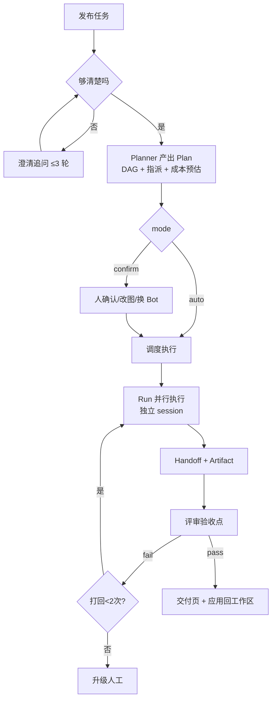

# DSHBot 需求规格 v1.0

> ⚠️ 已被 [DSHBot-需求规格-v1.1.md](DSHBot-需求规格-v1.1.md) 取代：v1.1 把交互模型从"任务看板"重构为"房间即任务"，并补入 Grok Bot 式的工位、旁观接管、审批闸门。

> **一句话**：DSHBot 是 DSH 的任务编排插件 —— 发布一条任务，它按需组建一支 Bot 小队，自动拆解、并行执行、交叉评审，交付可验收的产物与完整过程记录。

| 项 | 内容 |
|---|---|
| 版本 | v1.0（决策已锁定，取代 v0.1） |
| 定位 | DSH 插件包 + CLI，个人自用起步，开源分发 |
| 基线 | DeepSeek Harness（cordis 插件栈） |
| 日期 | 2026-11-06 |

---

## 1. 问题与主张

DSH 擅长"一个 agent 把一件事做好"，但真实任务是多角色的：需求要澄清、方案要设计、代码要写、要测、要评。现在只能人肉开多个会话、手动搬上下文、手动收口。

**主张**：把「多 Bot 协作」做成一次发布、自动编排、全程可视、结果可验收。DSH 提供执行原语，DSHBot 提供**任务层**：谁来做、按什么顺序、交付什么、怎样算过。

---

## 2. 形态决策（关键）

你选的三项看似冲突（插件形态 + 独立 Web 看板 + CLI），实际可以合成一套：

```
┌──────────────────────────────────────────────────────────┐
│  @yourscope/dsh-bot  （一个 npm 包，开源）                 │
│                                                          │
│  core/    编排内核：Task / Bot / Plan / Run / Artifact    │
│          纯 TS，不依赖 DSH，可单测、可复用                 │
│  cli/     dsh-bot new / run / status / bots               │
│  plugin/  cordis 插件：注册任务中心页面 + RPC + 工具       │
└──────────────────────────────────────────────────────────┘
          │ 安装：dsh plugin --profile web add @yourscope/dsh-bot
          │ 装配：cordis.patch.yml 插入条目
          ▼
   DSH Web GUI 内多一个「任务中心」页（可单独浏览器标签打开）
```

**结论**：不单独起一个服务进程。看板是插件注册进 DSH Web 的页面，天然满足"Web 看板"；CLI 与插件共用 `core`，满足脚本化发布；整个包就是一个可 `pnpm add` 的插件，满足开源分发。

**为什么不做独立服务**：多一个进程就多一套鉴权、端口、生命周期、升级路径，个人自用场景纯属负担。真要做多人共享时，把 `core` 抽出来套个 HTTP 壳即可 —— 所以 `core` 必须与 DSH 解耦。

---

## 3. 核心概念

| 概念 | 定义 | 关键点 |
|---|---|---|
| **Bot** | 持久化实体：有名字、人格、能力、记忆、履历 | 可被 @ 调用、可被任务指派、可导出分享 |
| **Task** | 一次发布 | 目标、材料、验收标准、预算、执行模式 |
| **Plan** | 任务的 DAG 方案 | 节点=子任务，边=依赖，节点含指派与输出契约 |
| **Subtask** | Plan 的节点 | 描述、指派 Bot、输入引用、**输出契约**、验收点 |
| **Run** | 一次 Bot 执行 | 独立 session、事件流、成本、产物 |
| **Handoff** | Bot 间交接包 | 结论 + 产物引用 + 未决问题（不传全量对话） |
| **Artifact** | 产物 | 文件/diff/报告，带生产者与版本 |
| **Review** | 评审结论 | 验收点三态：pass / fail / 存疑 |

### 3.1 Bot 模型（你选了「持久化实体」）

```yaml
# bot 卡：可导出、可分享、可版本化（开源后的传播单元）
id: bot_frontend_eng
name: 前端工程师·小柯
avatar: "🧑‍💻"                 # 看板里好认
persona: |
  你是资深前端工程师……
capabilities:
  tools: [read, edit, bash, browser]     # 工具白名单
  skills: [office-xlsx]                  # 技能包
  model: deepseek-flash                  # 可不同 Bot 不同模型
  budget: { perRun: 200k, perTask: 1M }  # token
memory:
  scope: project                          # none | project | global
  maxEntries: 200                         # 硬上限，逼着提炼
stats: { runs: 12, passRate: 0.83 }       # 自动累积的履历
```

**三种存在形态**

1. **库内 Bot**：持久、有记忆、可直聊，跨任务复用；
2. **任务 Bot**：任务内自动派生（如"评审员#2"），任务结束默认归档；
3. **转正**：任务 Bot 表现好，一键沉淀为库内 Bot（带本次履历）。

> 这条设计回应了"自动创建 Bot"与"Bot 是持久实体"的矛盾：**派生是常态，转正是选择**。

**记忆分层**（这是持久化 Bot 最容易做烂的地方）

| 层 | 内容 | 生命周期 | 写入方式 |
|---|---|---|---|
| 工作记忆 | 当前 Run 的上下文 | Run 结束即弃 | 自动 |
| 长期记忆 | 项目知识、约定、踩过的坑 | 跨任务 | **必须提炼后写入**，禁止灌 transcript |
| 履历 | 次数、通过率、平均成本 | 永久 | 自动统计 |

硬规则：长期记忆有容量上限，超限按"最近使用 + 重要度"淘汰；每条记忆可查看、可删除、可标注来源任务。

### 3.2 任务模型

```yaml
task:
  goal: "给 CLI 加 --dry-run 参数并补测试"
  inputs: [workspace: ./repo]          # 文件/目录/链接
  acceptance:                          # 必填，缺了就追问
    - "dsh run --dry-run 不产生任何文件写入"
    - "新增测试覆盖 dry-run 分支且全绿"
  constraints: { deadline: 2h, budget: 2M, stack: TypeScript }
  mode: confirm                        # confirm | auto
  bots: [bot_planner, bot_engineer, bot_tester]   # 可留空，全自动选
```

---

## 4. 两种执行模式（你要求两个都要）

| 模式 | 行为 | 什么时候打断人 | 适用 |
|---|---|---|---|
| **confirm**（默认） | 规划完成即停，等人确认/改图，再执行 | 规划后一次 | 首次任务、高风险改动 |
| **auto** | 规划即执行，全程不打断 | 预算熔断、连续失败 2 次、危险操作 | 熟悉的任务类型、批量跑 |

模式是**任务级**开关，也可由任务模板预设默认值。auto 模式仍保留"随时手动暂停"。

---

## 5. 主流程



**不可妥协的四条规则**

1. **契约先行**：没有输出契约的子任务不准派发 —— 否则下游只能猜。
2. **单写者**：同一文件同一时刻只有一个 Bot 能写；并行写作按文件分区，冲突走串行合并。
3. **上下文经济**：Bot 之间只传 Handoff，不传 transcript —— 否则上下文爆炸、噪声放大、成本失控。
4. **可拦截**：任一阶段可暂停/取消；危险操作（删文件、推远端、外发请求）默认需人审。

---

## 6. 功能需求

P0 = MVP；P1 = 第二版；P2 = 以后。

### 6.1 任务中心

| 编号 | 需求 | 优先级 | 验收点 |
|---|---|---|---|
| FR-01 | 发布任务：一句话 + 附件 + 验收标准 | P0 | 3 步内建好一个任务 |
| FR-02 | 澄清追问 ≤3 轮，问题可一键采纳 | P0 | 缺验收标准必追问 |
| FR-03 | 任务列表/详情，实时状态 | P0 | 状态变化 2s 内可见 |
| FR-04 | 暂停/恢复/取消/重跑 | P0 | 取消后无孤儿进程 |
| FR-05 | 任务模板（常用类型的预设 Plan 玩法） | P1 | 选模板省掉澄清 |
| FR-06 | Plan 可视化（只读 DAG 图） | P0 | 节点状态实时着色 |

### 6.2 Bot 管理

| 编号 | 需求 | 优先级 | 验收点 |
|---|---|---|---|
| FR-07 | Bot 卡 CRUD：人格、工具、技能、模型、预算 | P0 | 改配置不影响进行中的 Run |
| FR-08 | 内置 4 个 Bot：规划者/执行者/评审者/汇总者 | P0 | 装好即能跑通示例任务 |
| FR-09 | 任务内派生 Bot，可转正沉淀 | P0 | 转正后带履历 |
| FR-10 | Bot 直聊（人干预某个 Bot） | P1 | 对话进审计 |
| FR-11 | Bot 卡导入/导出（开源传播） | P1 | 导出文件可被他人导入 |

### 6.3 编排引擎

| 编号 | 需求 | 优先级 | 验收点 |
|---|---|---|---|
| FR-12 | 自动拆解：目标 → Plan（DAG + 验收点） | P0 | 无环、覆盖全部验收点 |
| FR-13 | 指派：按能力/负载选 Bot，可人工覆盖 | P0 | 能指定"这个节点给某个 Bot" |
| FR-14 | 依赖调度 + 并发上限 | P0 | 满足依赖才启动，不超限 |
| FR-15 | Handoff 生成与校验 | P0 | 缺契约字段直接判失败 |
| FR-16 | 失败：重试 1 次 → 降级 → 升级人工 | P0 | 保留首次失败日志 |
| FR-17 | 三级预算熔断：Run / Bot / Task | P0 | 超支立即停并出明细 |
| FR-18 | 人工改图（增删节点、改依赖、换 Bot） | P0 | 改完重新校验再执行 |

### 6.4 评审与交付

| 编号 | 需求 | 优先级 | 验收点 |
|---|---|---|---|
| FR-19 | 验收点三态判定（pass/fail/存疑） | P0 | 每条都有结论，不许空着 |
| FR-20 | 打回上限 2 次，超限升级人工 | P0 | 打回意见结构化 |
| FR-21 | 产物登记 + 版本链 | P0 | 同名不覆盖 |
| FR-22 | 交付页：产物 + 变更说明 + 验收结论 + 成本 | P0 | 一页看完 |
| FR-23 | 一键应用回工作区（diff 预览 + 回滚） | P0 | 应用前必预览 |
| FR-24 | 多评审者与分歧呈现 | P1 | 分歧显式，不取平均 |

### 6.5 可观测

| 编号 | 需求 | 优先级 | 验收点 |
|---|---|---|---|
| FR-25 | 实时时间线：每个 Bot 在做什么 | P0 | 断线重连不丢事件 |
| FR-26 | 成本面板：任务/节点/Bot 维度 | P0 | 与 token 账单口径一致 |
| FR-27 | 审计日志导出 | P0 | 含输入/输出/工具调用/审批 |
| FR-28 | 复盘报告（决策链 + 返工点） | P2 | 一键生成 |

### 6.6 集成

| 编号 | 需求 | 优先级 | 验收点 |
|---|---|---|---|
| FR-29 | CLI：`dsh-bot new / status / bots` | P0 | 一条命令建任务 |
| FR-30 | 插件装配：`dsh plugin add` 后出现任务中心页 | P0 | 无需改 DSH 源码 |
| FR-31 | Git：分支/提交/PR | P1 | 产物可直接开 PR |
| FR-32 | IM 通知 + 审批回执 | P2 | 飞书/钉钉任一 |

---

## 7. 非功能需求

| 维度 | 要求 |
|---|---|
| 隔离 | 每个 Run 独立 DSH session + 独立工作目录；写权限限定在任务 workspace |
| 并发 | 单机 ≥ 4 Run 并行；10 并发不崩（需实测） |
| 恢复 | 插件重启后任务可续跑，不丢已完成节点 |
| 成本 | 超预算硬停；预估误差目标 < 30% |
| 时延 | 建任务 < 2s；事件到看板 < 2s；Run 启动 < 5s |
| 安全 | 凭证不进 Bot 上下文；危险操作默认需审批 |
| 可审计 | 全事件 NDJSON 追加落盘，可按任务重放 |
| 开源 | MIT 协议；`pnpm add` 即装；无私有依赖 |

---

## 8. 技术方案（基于已确认的 DSH 能力）

已实测存在的入口：

- `dsh headless "<任务>" --json` → NDJSON 事件流，**一个 Run 一个进程**；
- `dsh --profile headless --session-id <id>` → 续跑同一 session；
- `dsh plugin --profile web add <pkg>` + `cordis.patch.yml` → 插件装配；
- Profile bundle = `@deepseek-ai/dsh-base` + `dsh-web-app`，插件是 cordis 插件。

**两种 Run 执行方式，需技术验证后二选一：**

| 方案 | 做法 | 优点 | 风险 |
|---|---|---|---|
| **A 子进程** | 每个 Run spawn `dsh headless --json` | 崩溃隔离、可并行、事件天然流式 | 进程开销；嵌套启动同一 Electron 二进制需验证；工作区授权要传对 |
| **B 同进程** | 插件内用 agent/session API 起子会话 | 零启动开销、共享鉴权与沙箱 | 一个 Run 卡死拖累整个宿主 |

**倾向 A**（隔离优先，且事件模型最干净），但 **T1 必须先验证**：10 并发子进程的耗时、失败率、内存、工作区权限是否正确。验证不过再退 B。

**目录结构（仓库）**

```
dsh-bot/
  packages/
    core/        # Task/Bot/Plan/Run 状态机、调度、Handoff —— 零 DSH 依赖
    cli/         # dsh-bot 命令
    plugin/      # cordis 插件 + 前端页面
  examples/      # 两个可跑示例任务
  docs/          # 本文档 + Bot 卡规范
```

---

## 9. MVP 范围（第一版就做这些）

**做**

1. 单用户、本地、插件安装；
2. 4 个内置 Bot + Bot 卡 CRUD；
3. 一句话发布 → 澄清 → 自动 Plan（2–4 节点）→ confirm/auto 两种模式；
4. 多 Run 并行、Handoff 传递、验收点三态评审；
5. 任务中心页：列表 / DAG / 时间线 / 成本 / 交付页；
6. 预算熔断 + 失败重试 1 次 + 打回 2 次；
7. 产物应用回工作区（带 diff 预览与回滚）。

**不做**

多用户与权限、IM 接入、模板市场、跨任务学习、可视化改图（只读即可）、移动端、云部署。

**验收演示**（三条全过才算 MVP 成立）

- D1：新装环境 `dsh plugin add` 后，任务中心页出现，内置 4 个 Bot 可见；
- D2：发布"给仓库加一个 CLI 参数并补测试"，confirm 模式下 20 分钟内交付可合并的 diff + 测试报告；
- D3：auto 模式跑同一任务，中途注入一次失败（故意让测试挂），系统能重试并在预算内收口。

---

## 10. 里程碑

| 里程碑 | 内容 | 出口标准 |
|---|---|---|
| **M1 内核** | core 状态机 + 单 Bot 执行 + CLI 发布 | CLI 能跑通"一个 Bot 干完一件事"并落产物 |
| **M2 多 Bot** | Plan + 调度 + 并行 + Handoff + 评审 | 一次任务 3 个 Bot 并行协作完成 |
| **M3 插件** | cordis 插件 + 任务中心页 + 打包开源 | `dsh plugin add` 后 GUI 内完整跑通 D2 |

先 M1 后 M2，是因为**单 Bot 的 Run 生命周期**（事件、成本、产物、失败）是所有上层能力的底座，这里不稳，多 Bot 全是空中楼阁。

---

## 11. 风险

| # | 风险 | 应对 |
|---|---|---|
| R1 | 自动拆解质量不稳 | 模板化 Plan 兜底 + 必须过校验 + 人工改图 |
| R2 | 持久 Bot 记忆越跑越蠢 | 记忆必须提炼写入 + 容量上限 + 可删可溯源 |
| R3 | 并行写文件冲突 | 单写者 + 文件分区 + 串行合并 |
| R4 | 子进程方案跑不动（T1 失败） | 退同进程方案 B |
| R5 | 评审 Bot 变"好好先生" | 验收点必须客观可判；评审与执行用不同 Bot |
| R6 | 成本失控 | 三级熔断 + 模型分级（规划用强、执行用快） |
| R7 | 插件 API 不稳定（版本升级） | core 与 DSH 解耦；插件层做薄适配 |

---

## 12. 决策记录

| # | 问题 | 结论 |
|---|---|---|
| Q1 | Bot 是什么 | **持久化实体** + 任务派生 + 转正机制 |
| Q2 | 使用范围 | 个人自用，**以 DSH 插件形式开源** |
| Q3 | 任务入口 | DSH GUI 任务中心页 + `dsh-bot` CLI（同一套 core） |
| Q4 | 编排方式 | **confirm 为默认，auto 可选**，任务级开关 |
| Q5 | MVP 第一刀 | **端到端最小闭环**（M1→M2→M3） |

**仍待验证（非需求问题，是工程问题）**

- T1 子进程并发可行性（第 8 节）；
- T2 插件能否注册独立页面路由与前端构建产物（需查 `dsh-web-app` 的 client 插件约定）；
- T3 每 Run 的工作区授权如何从插件传给子进程。

---

## 13. 下一步产出

1. `docs/bot-card.schema.json` —— Bot 卡规范；
2. `docs/task.schema.json` —— 任务与 Plan 结构；
3. `docs/event-protocol.md` —— Run 事件协议（NDJSON 行格式）；
4. 里程碑排期与首版 Issue 拆分。
