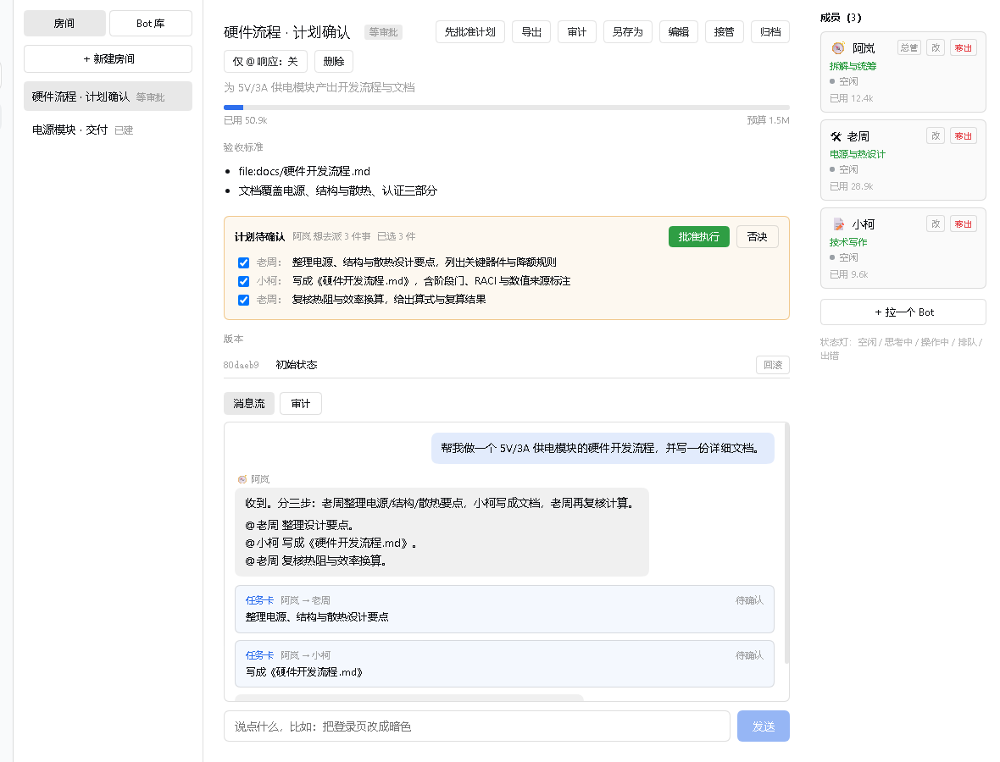

# DSHBot Rooms

**Open a room in DSH, invite role-based bot teammates, say one sentence, and let them split the work.**

You set the goal, approve the plan, and review the deliverables.

> Chinese: [README.md](README.md) · Version **0.2.0** · 100+ tests · **No third-party runtime dependencies**



## What makes it different

- **A room is a task**: one goal plus acceptance checks. `file:path` and `cmd:command` are judged by the machine, not by the model, and cost zero tokens.
- **The host plans first**: in `confirm` mode you see the plan before anything runs. You can approve **only some items**; the rest are marked `skipped`.
- **Each bot has its own session**: every turn gets a small, freshly assembled room context (≤2400 chars) instead of everyone else's history.
- **Deliverables are traceable**: the workspace has an isolated snapshot repository, so diff and rollback never touch your own git repo. The delivery panel previews the actual files.

## Quick start

### A. Install from a release (no Node/pnpm required)

1. Download `dshbot-plugin-v0.2.0.zip` from [Releases](../../releases) and unzip it, e.g. to `%USERPROFILE%\dshbot-plugin`.
2. Install it with DSH's bundled CLI:

   ```powershell
   dsh plugin --profile desktop add "link:%USERPROFILE%\dshbot-plugin"
   ```

3. Restart DSH. A 🏠 **Rooms** entry appears in the sidebar.

The package declares `dsh.bundle.patch`, so you do **not** need to edit `cordis.patch.yml` by hand.

### B. From source

```powershell
pnpm install
pnpm check
pnpm install:profile
# restart DSH
```

## Features

| Area | What you get |
|---|---|
| Rooms & acceptance | Goals, multiple checks, machine-judged `file:` / `cmd:`, warning when every check is prose |
| First run | One-click demo room with three roles and machine-checkable acceptance |
| Multi-bot work | Host plans, `@name` dispatch, task cards, handoff summaries |
| Plan gate | confirm / auto modes; partial approval; skipped cards |
| Bot library | Persona, expertise, output rules, agent preset; JSON export/import |
| Team templates | Save a group of bots; one-click when creating a room |
| Member ops | Edit or remove a bot inside a room without recreating it |
| Delivery | Changed files, diff, version snapshots, rollback, Markdown/audit export |
| File browser | Delivery panel "Files" tab; Markdown preview |
| Search | Full-history search with context snippets and sender names |
| Scale | Per-room `messages.jsonl`, paginated loading; `rooms.json` only stores rooms |
| Guardrails | Per-run / per-bot / per-room budgets editable in the UI, stop button, self-healing, timeout marker |

## Compatibility and limits

- Built for **DSH 0.2.1-rc.5** (Windows). The plugin injects `webServer`, `agents`, `sessions`, and `sessionController`; other DSH versions may break.
- No Node, pnpm, Python, or admin rights needed to install a release. `git` is optional (version snapshots and diff degrade without it).
- In-room approval cards, hard write locks, and per-tool streaming are **not implemented** because DSH does not expose the required hooks.
- The local HTTP API is loopback-only and unauthenticated; `cmd:` acceptance runs commands with your user privileges. See [SECURITY.md](SECURITY.md).

## Data and privacy

Data lives in `%USERPROFILE%\.dsh\dshbot\` (`rooms.json` + `rooms/<id>/messages.jsonl`). There is **no telemetry**; the only network calls come from DSH when it talks to the model.

## Development

```powershell
pnpm check
pnpm test:coverage
pnpm drill                    # full flow with a fake host, 0 tokens
pnpm drill -- --port 54873    # against a live DSH instance (costs tokens)
```

See [CONTRIBUTING.md](CONTRIBUTING.md) and the design notes in [STATE.md](STATE.md) / [M1-技术方案.md](M1-技术方案.md).

## License

[MIT](LICENSE)
