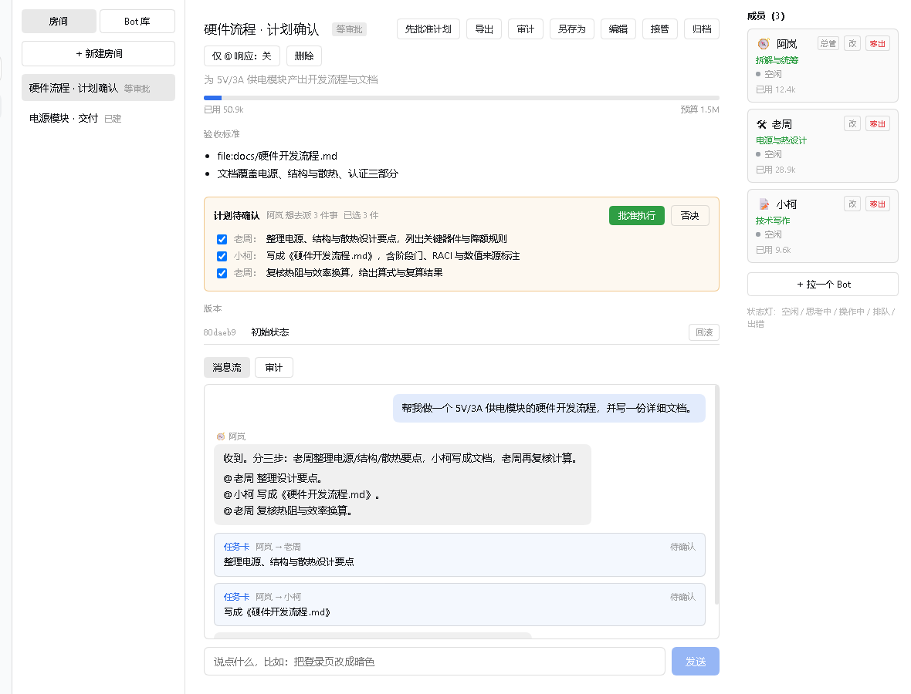
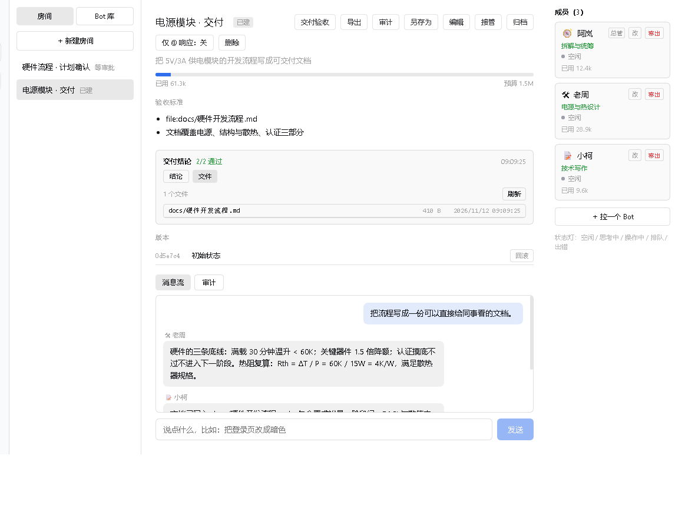
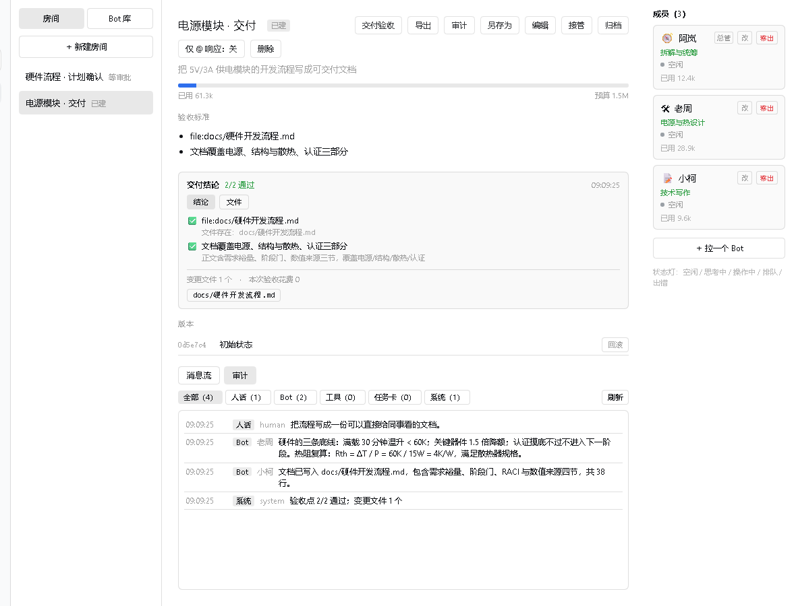
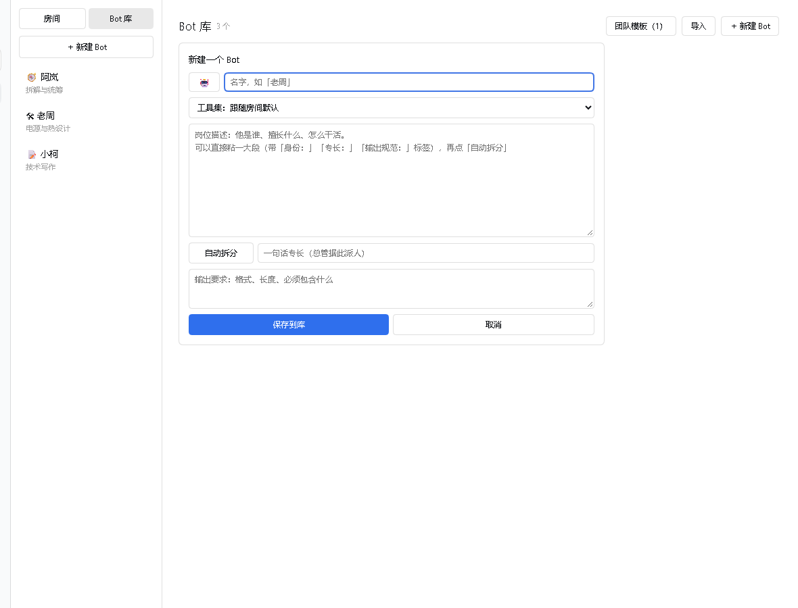

# DSHBot Rooms

**在 DSH 里开一个房间，拉几个有名字、有岗位的 Bot 同事进来，说一句话，它们分头干活。**

你只需要做三件事：定目标、批计划、验产物。其余交给房间。

> English: [README.en.md](README.en.md) · 当前版本 **v0.2.0** · 100+ 个用例 · 运行时**零第三方依赖**



## 为什么不是"再套一层聊天框"

普通的多 Agent 对话，最后往往变成"几个 Bot 互相复述"。DSHBot 把协作压到四个可检查的环节：

1. **房间 = 任务**：一个目标 + 若干条验收标准；验收可以写成 `file:路径` / `cmd:命令`，由机器判，不花 token；
2. **总管先出计划**：confirm 模式下先给你看要派几件事，可以全批、**勾选部分批准**，没选中的标 `skipped`；
3. **执行者各干各的**：一人一个 session，每轮只拼一小段房间近况（≤2400 字），不灌别人的历史；
4. **交付可追溯**：工作区有独立快照仓库，能看 diff、回滚；交付面板直接读产物正文；审计可导出 JSONL。

## 30 秒上手

### 方式 A：下载 Release（不需要 Node / pnpm）

1. 从 [Releases](../../releases) 下载 `dshbot-plugin-v0.2.0.zip`，解压到一个固定目录，例如 `%USERPROFILE%\dshbot-plugin`；
2. 用 DSH 自带的 CLI 装进你的 profile：

   ```powershell
   dsh plugin --profile desktop add "link:%USERPROFILE%\dshbot-plugin"
   ```

   （`dsh` 在 DSH 安装目录的 `resources\runtime\cli\bin\` 下；找不到就把该目录加进 PATH。）
3. **重启 DSH**，侧栏出现 🏠「房间」。

包内已经声明 `dsh.bundle.patch`，**不需要手改 `cordis.patch.yml`**。

### 方式 B：从源码

```powershell
pnpm install
pnpm check                # 类型检查 + 构建 + 100+ 个用例
pnpm install:profile      # 构建、装进 desktop profile、迁移旧补丁
# 重启 DSH
```

## 能做什么

| 能力 | 说明 |
|---|---|
| 房间与验收 | 目标、多条验收；`file:` / `cmd:` 机器判定；全是文字验收时给 warning |
| 多 Bot 协作 | 总管拆活、按 `@名字` 派活、任务卡生命周期、handoff 结论摘要 |
| 计划确认 | confirm / auto 两种模式；**部分批准**，未选中的任务卡标 `skipped` |
| Bot 库 | 岗位、专长、输出规范、工具集（agent preset）；导出 / 导入 JSON |
| 团队模板 | 常一起干活的几只 Bot 存成团队，建房一键拉入 |
| 成员运维 | 房间内直接改名字/岗位/专长/工具集，或移出，不用重建房间 |
| 交付 | 变更文件、diff、版本快照与回滚、导出 Markdown / 审计 JSONL |
| 产物浏览 | 交付面板「文件」tab 直接列出工作区文件，`.md` 按 Markdown 渲染 |
| 审计 | 「消息流 / 审计」tab，按类型筛，点开看工具参数与输出 |
| 规模 | 消息按房间存 `messages.jsonl`，分页加载；`rooms.json` 只存房间 |
| 成本护栏 | 单轮 / 单人 / 房间预算，界面可改；到线拒跑；超支留痕 |
| 可靠性 | 启动自愈、停止按钮、超时标注、预算熔断、失败隔离 |

### 截图

| 交付产物 | 审计 |
|---|---|
|  |  |

| Bot 库与团队模板 |
|---|
|  |

## 安装与兼容

- 详细步骤、卸载与排错见 [INSTALL.md](INSTALL.md)；
- 已在 **DSH 0.2.1-rc.5**（Windows）上验证；插件依赖 DSH 的 `webServer` / `agents` / `sessions` / `sessionController`，其他版本可能不兼容；
- **不需要** Node、pnpm、Python 或管理员权限；系统 `git` 可选（没有时版本快照/diff/回滚降级，不影响主流程）。

## 已知限制

这些是宿主接口决定的，硬做只能是假的：

- **房间内审批卡**：DSH 不暴露工具调用拦截钩子，现依赖 DSH 自带审批 + 计划确认；
- **硬写锁**：现在是软约束（任务里抽文件声明 + 冲突提醒）；
- **逐条工具事件推流**：服务端 1.2s 快照 + 内存活动行，不是逐 token 流；
- **依赖编排（DAG）**：目前靠提示词约束"先上游后下游"。

另外：API 只监听回环、不做鉴权；`cmd:` 验收会执行你写的命令。请阅读 [SECURITY.md](SECURITY.md)。

## 数据与隐私

- 数据在 `%USERPROFILE%\.dsh\dshbot\`：`rooms.json`（房间/Bot/团队）+ `rooms/<id>/messages.jsonl`；
- **没有遥测**，不向任何分析服务上报；网络请求只发生在 DSH 调用模型时；
- 旧版本 `rooms.json` 里的消息会在首次读取时自动迁移到分文件（按消息 id 去重）。

## 开发

```powershell
pnpm install
pnpm check        # lint + 类型 + 构建 + 全部测试
pnpm test:coverage # 覆盖率门槛
pnpm drill        # 一条命令演完：建房→派活→产出→验收（默认假宿主，0 token）
pnpm drill -- --port 54873   # 打真实实例（会花 token）
```

架构与决策：[STATE.md](STATE.md)、[TASKS.md](TASKS.md)、[M1-技术方案.md](M1-技术方案.md)；
贡献前请读 [CONTRIBUTING.md](CONTRIBUTING.md)。

## License

[MIT](LICENSE)
